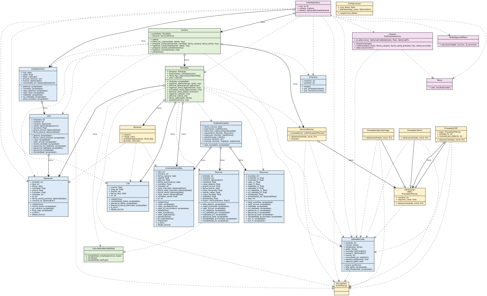

# Portafolio de inversión

Programa de escritorio (Python + tkinter, tema oscuro) para comprar acciones con un saldo virtual de **$10.000.000 COP**,
ver su precio histórico real en pesos, seguir sus ganancias **realizadas** y **no realizadas** y, aparte, registrar CDT.



## La interfaz: dos pestañas

**1. Invertir**
- Lista desplegable de empresas con su nombre conocido (Nike, Coca-Cola, Apple, Microsoft, Tesla, Netflix, Ecopetrol…).
- Al elegir una empresa muestra el **precio actual de la acción en COP**.
- Se ingresan las acciones a comprar, la fecha de compra y la fecha de venta prevista.
- **Confirmar compra** registra la operación, descuenta su costo del saldo y dibuja la gráfica del precio **desde la compra hasta la venta prevista**. **Haga clic (o arrastre) sobre la línea** para ver el precio de la acción ese día.
- Si la fecha de venta aún no llega, la posición queda **abierta** con su valor actual y **la venta no se registra**. Cuando la fecha llega (al abrir el programa o pulsar *Actualizar precios*) la venta se registra automáticamente al precio de cierre de ese día y el dinero se abona al saldo.

**2. Resumen e historial**
- Saldo disponible, valor de las posiciones abiertas, valor total del portafolio, ganancia realizada y ganancia no realizada. Verde = ganancia, rojo = pérdida.
- Tabla de posiciones abiertas e historial claro de compras y ventas.
- Sección **CDT** independiente y sencilla (ver más abajo).

## Requisitos

| Necesita | Detalle |
|---|---|
| Python | 3.9 o superior (desarrollado y probado con 3.12) |
| tkinter | Viene con Python en Windows y macOS. En Linux: `sudo apt install python3-tk` |
| Internet | **Sí**, para consultar precios. Sin conexión puede abrir el programa y ver su historial, pero no precios ni compras |
| Clave API | **No** |
| Pago | Ninguno |

## Instalación y ejecución

```bash
python -m venv .venv
# Windows:  .venv\Scripts\activate        macOS/Linux:  source .venv/bin/activate
pip install -r requirements.txt     # si "pip" no se reconoce en Windows: python -m pip install -r requirements.txt
python main.py
```

Las operaciones y los CDT se guardan en `datos/cartera.json` (esta versión usa un archivo nuevo; el `portafolio.json` de la versión anterior no se mezcla porque estaba en dólares). Otro archivo: `python main.py --datos ruta/mi_cartera.json`.

## Fuente de datos y conversión a COP

- **Precios de acciones:** Yahoo Finance mediante la biblioteca `yfinance`. Gratis, sin clave. Es una herramienta **no oficial**: puede fallar, cambiar o limitar el acceso.
- **Pesos colombianos:** Yahoo entrega las acciones en dólares. Cada precio se multiplica por la tasa **USD/COP de Yahoo (`COP=X`) del mismo día**. Es una tasa de mercado de Yahoo, **no la TRM oficial**, por lo que puede diferir de la TRM.
- **Son cierres diarios, no tiempo real.** El "precio actual" es el último cierre disponible; la pantalla muestra su fecha y la fuente.
- Si Yahoo falla o no reconoce la empresa, el programa muestra un error claro y **no inventa precios**.
- `ProveedorAlphaVantage` sigue en el código, pero **no está conectado** en esta versión: no entrega la tasa de cambio necesaria para convertir a COP.

## Cómo se calculan los resultados

| Concepto | Cálculo |
|---|---|
| Costo de la compra | acciones × precio de cierre en COP del día de compra |
| Saldo disponible | 10.000.000 − compras + ventas ya registradas |
| Valor actual (posición abierta) | acciones × último cierre en COP |
| **Ganancia no realizada** | valor actual − costo (en papel; cambia con el precio) |
| Dinero de una venta | acciones × cierre en COP del día de venta |
| **Ganancia realizada** | dinero recibido − costo (solo posiciones ya vendidas) |
| Valor total del portafolio | saldo disponible + valor de las posiciones abiertas |

Cada compra se mide por separado (su propio costo y su propia fecha de venta). Los splits de acciones posteriores a la compra se ajustan.

**Incluido / no incluido:** no hay comisiones del bróker, impuestos, dividendos ni costos de cambio de moneda en estos cálculos. Las compras se hacen al cierre histórico de la fecha elegida (no a precios intradía) y no se permiten fechas de compra futuras.

## CDT (sección independiente)

Un **CDT es un instrumento de deuda, no una acción**: usted presta dinero a un banco por un plazo y este le paga intereses.
Es independiente: **no usa ni cambia el saldo** de las acciones ni entra en su valor total.

- Se registra el **monto**, la **tasa efectiva anual**, la **fuente de la tasa** y su **fecha**. El programa **no inventa tasas**: escriba la que publica su banco o la Superintendencia Financiera (tasas de captación).
- **Rentabilidad diaria** = `(1 + tasa_anual)^(1/365) − 1`.
- **Estimación anual:** `monto × ((1 + rentabilidad_diaria)^365 − 1)`, que equivale a `monto × tasa E.A.` Supone que la tasa se mantiene 365 días y no descuenta retención en la fuente ni impuestos.

## Estructura

```
main.py                      # archivo principal
portafolio/
  empresa.py  operacion.py  lote.py  estado_cartera.py  cdt.py       # modelo
  cartera.py  portafolio.py  calculadora_rentabilidad.py            # reglas y cálculo
  datos_mercado.py  error_precios.py  almacen.py  configuracion.py
  proveedor_precios.py  proveedor_yahoo.py  proveedor_cop.py  proveedor_alphavantage.py  servicio_precios.py
  tema.py  grafica_interactiva.py  interfaz_grafica.py  tarea_segundo_plano.py   # interfaz
tests/        # 35 pruebas automáticas
tools/generar_uml.py     # genera el UML leyendo el código real
wiki/         # páginas e imágenes de la wiki
```

Una clase por archivo. Para regenerar el UML: `python tools/generar_uml.py` (el PNG requiere Graphviz).

## Pruebas

```bash
python -m unittest discover -s tests -t . -v
```

Verifican saldo, compras, ventas que no se registran antes de su fecha, splits, CDT y conversión a COP con datos **sintéticos** definidos solo en `tests/proveedor_falso.py`; la aplicación nunca los usa.

## Limitaciones

- Yahoo Finance es no oficial; puede fallar o bloquear consultas. La descarga real no se probó desde el entorno de desarrollo: pruebe con una empresa al abrir el programa.
- Cierres diarios: sin precios en tiempo real ni intradía. Para la gráfica del día de hoy se usa el último cierre disponible.
- La tasa USD/COP es de Yahoo, no la TRM oficial.
- Las ventas se registran cuando abre el programa o pulsa *Actualizar precios* en o después de la fecha prevista; no corre en segundo plano con el programa cerrado.
- Ecopetrol y Bancolombia se negocian como ADR en Nueva York (en dólares), no en la Bolsa de Colombia.
- Una sola moneda de trabajo (COP) y un solo saldo.
