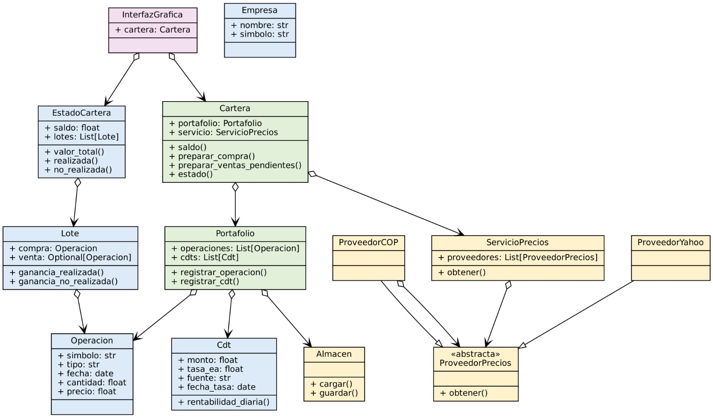

# Sistema de monitoreo y evaluación de un portafolio de inversiones

Aplicación de escritorio en **Python (tkinter)** para registrar, monitorear y evaluar un portafolio compuesto por **renta variable** (acciones) y **renta fija** (CDT, bonos y TES). Calcula valoración, ganancias realizadas y no realizadas, dividendos, comisiones, **rentabilidad acumulada** y **rentabilidad efectiva anual (E. A.)**.



## Contenido

1. [Alcance y estado actual](#alcance-y-estado-actual)
2. [Funcionalidades frente a la rúbrica](#funcionalidades-frente-a-la-rúbrica)
3. [Requisitos](#requisitos)
4. [Instalación y ejecución](#instalación-y-ejecución)
5. [Uso de la interfaz](#uso-de-la-interfaz)
6. [Metodología de cálculo](#metodología-de-cálculo)
7. [Ejemplo numérico](#ejemplo-numérico)
8. [Fuentes de datos](#fuentes-de-datos)
9. [Arquitectura y estructura del proyecto](#arquitectura-y-estructura-del-proyecto)
10. [Pruebas](#pruebas)
11. [Limitaciones](#limitaciones)
12. [Autores](#autores)

## Alcance y estado actual

El proyecto tiene dos capas, y conviene saber qué hace cada una:

| Capa | Qué incluye | ¿Se usa desde la interfaz? |
|---|---|---|
| **Motor de cálculo** (`Portafolio`, `InversionRentaFija`, `CalculadoraRentabilidad`, `Resumen`) | Acciones con compras/ventas parciales, comisiones, dividendos y splits; renta fija (CDT, BONO, TES) con valoración contractual, valor de mercado manual y venta anticipada; rentabilidad acumulada, E. A. (XIRR), totales y distribución renta fija / renta variable | **No.** Está implementado y cubierto por pruebas automáticas, pero la interfaz actual aún no lo invoca |
| **Interfaz gráfica** (`Cartera`, `InterfazGrafica`) | Compra de acciones con un saldo virtual de **$10.000.000 COP**, gráfica de precio, ganancia realizada / no realizada, historial y una sección CDT sencilla | Sí |

La interfaz de hoy registra compras **sin comisión** y **no muestra dividendos**, bonos, TES ni la E. A. del portafolio; esas funciones se ejercitan en las pruebas (`tests/test_calculos.py`) y están disponibles como API de Python (ver [Ejemplo numérico](#ejemplo-numérico)).

## Funcionalidades frente a la rúbrica

| Requisito de la rúbrica | Dónde está | Estado |
|---|---|---|
| Registrar compras y venta de acciones (fecha, cantidad, precio, comisión) | `Operacion`, `Portafolio.registrar_operacion` | Motor: sí. Interfaz: compra y venta programada, sin comisión |
| Registrar CDT, bonos y TES (fecha, valor, tasa, vencimiento, comisión) | `InversionRentaFija` (`tipo` = `CDT`, `BONO` o `TES`), `Portafolio.registrar_renta_fija` | Motor: sí. Interfaz: solo CDT simplificado (`Cdt`) |
| Dividendos de acciones | `Portafolio._calcular_posicion` (por fecha ex-dividendo) | Motor: sí (Yahoo Finance) |
| Intereses y rendimientos de renta fija | `InversionRentaFija.valor_causado` (capitalización a la tasa E. A.) | Motor: sí |
| Actualizar la valoración con precios de mercado y condiciones contractuales | Precios: `ServicioPrecios` + `ProveedorYahoo`. Renta fija: tasa, plazo y vencimiento, o `valor_mercado` manual con su fecha | Motor: sí. Interfaz: precios de acciones |
| Comisiones y costos en los resultados | Compra: suman al costo. Venta: restan al ingreso | Motor: sí |
| Rentabilidad acumulada y E. A. | `Resumen.rentabilidad_acumulada`, `CalculadoraRentabilidad.rentabilidad_ea` (XIRR) | Motor: sí |
| Total invertido, valor actual y distribución renta fija / variable | `Resumen` (`total_invertido`, `valor_actual`, `pct_rf`, `pct_rv`) | Motor: sí |

## Requisitos

| Necesita | Detalle |
|---|---|
| Python | 3.9 o superior (desarrollado y probado con 3.12) |
| tkinter | Viene con Python en Windows y macOS. En Linux: `sudo apt install python3-tk` |
| Librerías | `yfinance`, `matplotlib`, `pandas` (ver `requirements.txt`) |
| Internet | Sí, para consultar precios. Sin conexión se puede abrir el programa y ver el historial, pero no hay precios ni compras nuevas |
| Clave API | No |

## Instalación y ejecución

```bash
python -m venv .venv
# Windows:  .venv\Scripts\activate        macOS/Linux:  source .venv/bin/activate
pip install -r requirements.txt     # si "pip" no se reconoce en Windows: python -m pip install -r requirements.txt
python main.py
```

Los datos se guardan en `datos/cartera.json`. Para usar otro archivo:

```bash
python main.py --datos ruta/mi_cartera.json
```

(También se puede definir la variable de entorno `PORTAFOLIO_DATOS`.)

## Uso de la interfaz

**Pestaña 1 — Invertir**
1. Elija la empresa (Nike, Coca-Cola, Apple, Microsoft, Tesla, Netflix, Ecopetrol…): se muestra su precio actual en COP.
2. Escriba la cantidad de acciones, la fecha de compra y la fecha de venta prevista (`AAAA-MM-DD` o `DD/MM/AAAA`).
3. **Confirmar compra**: se descuenta del saldo y se dibuja la gráfica del precio desde la compra hasta la venta prevista. Al hacer clic sobre la línea se ve el precio de ese día.
4. Si la fecha de venta aún no llega, la posición queda **abierta** y la venta **no** se registra. Cuando la fecha llega (al abrir el programa o pulsar *Actualizar precios*) se registra al cierre de ese día y el dinero vuelve al saldo.

**Pestaña 2 — Resumen e historial**
- Tarjetas: saldo disponible, valor de las posiciones abiertas, valor total, ganancia realizada y no realizada (verde = ganancia, rojo = pérdida).
- Tabla de posiciones abiertas e historial de compras y ventas.
- Sección **CDT**: monto, tasa E. A., fuente y fecha de la tasa; muestra la rentabilidad diaria y una estimación anual.

## Metodología de cálculo

### Acciones (método de costo promedio)

| Concepto | Cálculo |
|---|---|
| Costo de una compra | `cantidad × precio + comisión` |
| Ingreso neto de una venta | `cantidad × precio − comisión` |
| Costo dado de baja en una venta | `costo abierto × (cantidad vendida / cantidad en cartera)` |
| Ganancia realizada | ingreso neto − costo dado de baja |
| Valor actual | `cantidad abierta × último cierre` |
| Ganancia no realizada | valor actual − costo abierto |
| Dividendos | `acciones que había el día anterior a la fecha ex-dividendo × dividendo por acción` (quien compra desde la fecha ex no lo recibe) |
| Splits | las cantidades se ajustan a los splits posteriores a cada operación |

### Renta fija (CDT, BONO, TES)

| Concepto | Cálculo |
|---|---|
| Costo | `capital + comisión de compra` |
| Valor causado a una fecha | `capital × (1 + tasa E. A.)^(días / 365)`, con tope en el vencimiento |
| Valor actual, vigente | valor de mercado manual (si se indicó y su fecha ya pasó); si no, el valor causado |
| Valor actual, vencida | valor al vencimiento (capital + intereses) |
| Valor actual, vendida antes de vencer | `valor recibido − comisión de venta` |
| Ganancia | valor actual − costo (realizada si está vendida o vencida; no realizada si sigue vigente) |

### Consolidado del portafolio

| Indicador | Cálculo |
|---|---|
| Total invertido | compras de acciones (con comisión) + costo de la renta fija |
| Valor actual | valor de las acciones + valor vigente de la renta fija |
| Ganancia total | realizada + no realizada + dividendos |
| **Rentabilidad acumulada** | `ganancia total / total invertido` |
| **Rentabilidad E. A.** | tasa `r` que cumple `Σ flujo_i / (1 + r)^(días_i / 365) = 0` (XIRR), resuelta por bisección |
| Distribución | `% renta variable = valor acciones / valor actual`, `% renta fija = valor renta fija / valor actual` |

Los flujos de la E. A. incluyen las compras y ventas con sus comisiones, los dividendos en su fecha ex y el valor actual como flujo final. La E. A. **no se calcula con menos de 30 días de historia**, porque anualizar un período tan corto sería extrapolar demasiado. Las monedas distintas **no se convierten ni se suman**: los totales se muestran por moneda.

### CDT simplificado de la interfaz
- Rentabilidad diaria = `(1 + tasa E. A.)^(1/365) − 1`
- Estimación anual = `monto × tasa E. A.` (supone que la tasa se mantiene 365 días; no descuenta retención en la fuente ni impuestos).

## Ejemplo numérico

Valores tomados de las pruebas automáticas, que verifican estos resultados.

**Acciones con comisiones y dividendos.** Compra de 10 acciones a 100 con comisión de 5 (costo 1.005). Venta de 4 a 120 con comisión de 3. Cierre actual de 130. Dividendos de 0,5 por acción pagados con 10 acciones (febrero) y con 6 (abril).

| Concepto | Resultado |
|---|---|
| Ganancia realizada (477 − 402) | 75 |
| Costo abierto (6 acciones) | 603 |
| Valor actual (6 × 130) | 780 |
| Ganancia no realizada (780 − 603) | 177 |
| Dividendos (5 + 3) | 8 |
| Ganancia total | 260 |
| Rentabilidad acumulada (260 / 1.005) | 25,87 % |
| Rentabilidad E. A. (XIRR sobre 179 días) | 90,43 % (anualizada a partir de un período corto) |

**CDT.** Capital de $1.000.000 a 12 % E. A., del 2025-01-01 al 2026-01-01: al vencimiento vale $1.120.000 y la ganancia es $120.000.

**Uso desde Python** (motor completo, con renta fija y E. A.):

```python
from datetime import date
from pathlib import Path
from portafolio.almacen import Almacen
from portafolio.portafolio import Portafolio
from portafolio.renta_fija import InversionRentaFija
from portafolio.servicio_precios import ServicioPrecios
from portafolio.proveedor_cop import ProveedorCOP
from portafolio.proveedor_yahoo import ProveedorYahoo

p = Portafolio(Almacen(Path("datos/cartera.json")))
p.registrar_renta_fija(InversionRentaFija(
    tipo="CDT", nombre="Banco X", fecha_compra=date(2025, 1, 1), capital=1_000_000,
    tasa_ea=0.12, fecha_vencimiento=date(2027, 12, 31), comision=2_000, moneda="COP"))

analisis = p.analizar(ServicioPrecios([ProveedorCOP(ProveedorYahoo())]))
r = analisis.resumenes["COP"]
print(r.total_invertido, r.valor_actual, r.rentabilidad_acumulada, r.rentabilidad_ea, r.pct_rf, r.pct_rv)
```

Con solo ese CDT (y sin acciones, así que no hace falta internet), el resultado al 2026-11-15 fue: total invertido 1.002.000, valor actual ≈ 1.236.227, rentabilidad acumulada ≈ 23,4 %, E. A. ≈ 11,9 %, 100 % renta fija y 0 % renta variable. Un CDT ya vencido se considera cobrado: deja de contar en el valor vigente.

## Fuentes de datos

| Dato | Fuente | Clave | Notas |
|---|---|---|---|
| Precios, dividendos y splits de acciones | Yahoo Finance (`yfinance`) | No | Herramienta no oficial: puede fallar o limitar el acceso |
| Tasa USD/COP | Yahoo Finance (`COP=X`) | No | Tasa de mercado de Yahoo, **no** la TRM oficial |
| Tasa, plazo y vencimiento de CDT, bonos y TES | La escribe el usuario | — | El programa no inventa tasas |
| Valor de mercado de renta fija | Opcional, lo escribe el usuario con su fecha | — | Si no se indica, se usa la causación contractual |

Yahoo entrega las acciones en dólares; cada precio se multiplica por la tasa USD/COP del mismo día. Son **cierres diarios**, no tiempo real. Si la fuente falla, el programa muestra un error claro y **no inventa precios**. `ProveedorAlphaVantage` existe en el código, pero no está conectado: no entrega dividendos, splits ni la tasa de cambio.

## Arquitectura y estructura del proyecto

```
main.py                         # punto de entrada
portafolio/
  empresa.py  operacion.py  lote.py  estado_cartera.py            # acciones y estado de la cartera
  cdt.py  renta_fija.py                                          # renta fija (CDT simple; CDT/BONO/TES completo)
  posicion.py  resumen.py  analisis_portafolio.py                # resultados por empresa y consolidados
  portafolio.py  cartera.py  calculadora_rentabilidad.py         # reglas y cálculo (motor)
  datos_mercado.py  error_precios.py  almacen.py  configuracion.py  utilidades.py
  proveedor_precios.py  proveedor_yahoo.py  proveedor_cop.py  proveedor_alphavantage.py  servicio_precios.py
  tema.py  grafica_interactiva.py  interfaz_grafica.py  tarea_segundo_plano.py   # interfaz
tests/                          # 35 pruebas automáticas (datos sintéticos)
tools/generar_uml.py            # genera el UML leyendo el código real
wiki/                           # documentación ampliada y diagramas
datos/                          # aquí se guarda cartera.json
```

Una clase por archivo. Capas: **modelo** (`Operacion`, `Lote`, `Cdt`, `InversionRentaFija`, `Posicion`, `Resumen`…), **reglas** (`Portafolio`, `Cartera`, `CalculadoraRentabilidad`), **datos** (proveedores, `ServicioPrecios`, `Almacen`) e **interfaz** (`InterfazGrafica`, `GraficaInteractiva`). La interfaz no calcula: consulta a `Cartera`, y las consultas a internet corren en segundo plano.

Para regenerar el diagrama UML: `python tools/generar_uml.py` (el PNG requiere Graphviz). Más detalle en la carpeta `wiki/`.

## Pruebas

```bash
python -m unittest discover -s tests -t . -v
```

35 pruebas: compras y ventas parciales, comisiones, dividendos, splits, renta fija (vigente, vencida, vendida, valor de mercado), XIRR y E. A., saldo, ventas programadas, conversión a COP y respaldo de fuentes. Usan datos **sintéticos** definidos solo en `tests/proveedor_falso.py`; la aplicación nunca los usa.

## Limitaciones

- La interfaz aún no expone comisiones, dividendos, bonos, TES ni la E. A. del portafolio; están en el motor y las pruebas (ver [Alcance](#alcance-y-estado-actual)).
- La renta fija se valora capitalizando a la tasa E. A. pactada: **no modela cupones periódicos** de bonos ni pagos parciales de capital. Para reflejar un precio de mercado de un bono o TES hay que indicar `valor_mercado` y su fecha.
- Yahoo Finance es una fuente no oficial; puede fallar o bloquear consultas.
- Cierres diarios: sin precios en tiempo real ni intradía.
- La tasa USD/COP es de Yahoo, no la TRM oficial.
- Ecopetrol y Bancolombia se negocian como ADR en Nueva York (en dólares), no en la Bolsa de Colombia.
- Las ventas programadas se registran al abrir el programa o pulsar *Actualizar precios*; no corre en segundo plano con el programa cerrado.
- El cálculo no incluye impuestos ni retención en la fuente.

## Autores

Equipo: Santiago Mosquera, Yeison Moreno.
