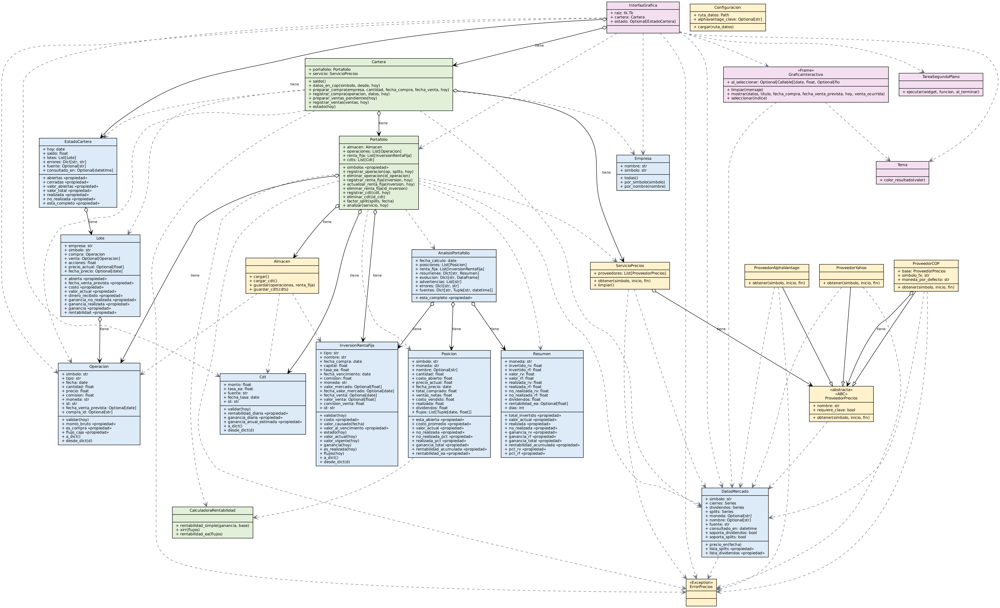

# Arquitectura y diagrama UML

Generado con `python tools/generar_uml.py` a partir de las clases reales (versión Mermaid: `wiki/diagrama_uml.mmd`). Una clase por archivo; `main.py` es el archivo principal.

| Capa | Clases |
|---|---|
| Modelo | `Empresa`, `Operacion`, `Lote`, `EstadoCartera`, `Cdt`, `DatosMercado`, `Posicion`, `Resumen`, `AnalisisPortafolio`, `InversionRentaFija` |
| Reglas | `Cartera` (saldo, compras, ventas, ganancias), `Portafolio`, `CalculadoraRentabilidad` |
| Datos | `ProveedorPrecios`, `ProveedorYahoo`, `ProveedorCOP`, `ProveedorAlphaVantage`, `ServicioPrecios`, `ErrorPrecios`, `Almacen`, `Configuracion` |
| Interfaz | `InterfazGrafica`, `GraficaInteractiva`, `Tema`, `TareaSegundoPlano` |

## Decisiones
- `ProveedorCOP` envuelve a Yahoo y convierte USD→COP día por día; el resto del programa solo ve pesos.
- Cada compra es un `Lote` con su fecha de venta prevista; la venta se crea solo cuando esa fecha llega.
- La interfaz no calcula: pide el `EstadoCartera` a `Cartera`. Las consultas a internet corren en segundo plano.
- Sin ventanas emergentes: los avisos aparecen dentro de la pantalla.
