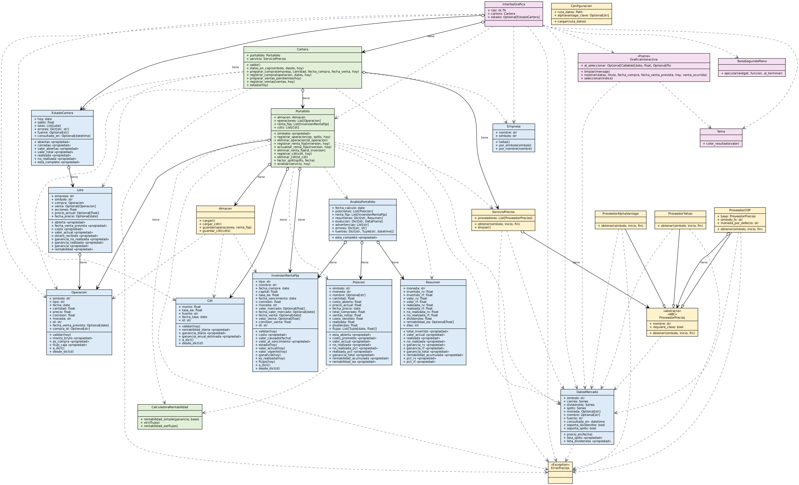

# Portafolio de inversión

Programa de escritorio en Python (tema oscuro) con **dos pestañas**: *Invertir* y *Resumen e historial*.

- [Instalación y uso](Instalacion-y-uso.md)
- [Arquitectura y diagrama UML](Arquitectura-y-UML.md)
- [Metodología de cálculo](Metodologia-de-calculo.md)
- [Fuentes de datos](Fuentes-de-datos.md)

| Requisito | Estado |
|---|---|
| Elegir empresa por su nombre conocido (Nike, Coca-Cola…) y ver su precio actual en COP | Sí |
| Comprar con fecha de venta prevista; gráfica interactiva con el precio al hacer clic | Sí |
| Venta futura no se registra antes de su fecha | Sí |
| Saldo inicial de $10.000.000 COP que baja al comprar y sube al vender | Sí |
| Ganancia realizada vs. no realizada e historial | Sí |
| CDT independiente con rentabilidad diaria `(1+tasa)^(1/365)-1` y estimación anual | Sí |
